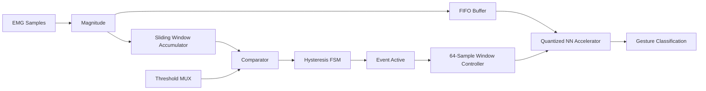

# event-driven-emg-soc

An event-driven SystemVerilog architecture for real-time EMG gesture recognition, combining low-cost signal activity detection with a quantized neural-network accelerator.

The system is designed to avoid unnecessary inference while meaningful muscle activity is absent. Once EMG activity is detected, the system collects fixed-size active-signal windows and forwards them to a hardware neural-network accelerator for gesture classification.

## System Architecture



The design consists of two primary subsystems:

1. An event detector that continuously monitors EMG activity.
2. A neural-network accelerator that performs gesture classification only when an event is active.

---

## Event Detector

The event detector estimates EMG activity using the magnitude of incoming signed samples.

For each sample:

```math
m[n] = |x[n]|
```

Instead of recomputing an entire window sum for every new sample, the detector uses a sliding-window accumulator:

```math
S[n] = S[n-1] + |x[n]| - |x[n-N]|
```

where:

- `N` is the detector window size
- `x[n]` is the newest sample
- `x[n-N]` is the oldest sample leaving the window

A FIFO stores previous magnitudes so the oldest value can be removed as each new value enters the window.

This reduces the sliding-window update to one addition and one subtraction per valid sample.

### Hysteresis Detection

The activity level is evaluated using separate high and low thresholds.

The detector uses three states:

- **Idle**
- **Active**
- **Cooldown**

A threshold multiplexer selects the appropriate threshold depending on the current detector state.

This hysteresis prevents rapid switching when the signal fluctuates near a single threshold.

The event detector therefore follows the approximate datapath:

```text
EMG Sample
    |
    v
Magnitude
    |
    v
FIFO -----> Oldest Magnitude
    |              |
    +-------> Sliding Sum
                 |
                 v
          Threshold Comparator
                 ^
                 |
          Threshold MUX
                 |
                 v
           Hysteresis FSM
                 |
                 v
             event_out
```

---

## Neural-Network Accelerator

When the event detector enters the Active state, active EMG samples are collected for neural-network inference.

The accelerator operates on fixed-size windows of:

\[
64 samples
\]

The 64-sample window is not a limit on the duration of an EMG event.

If the event remains active after one inference window, the system collects another 64 samples and performs another inference.

```text
Event becomes active
        |
        v
Collect 64 samples
        |
        v
Run inference
        |
        v
Is event still active?
     /       \
   Yes        No
    |          |
    v          v
Collect      Finish
next 64
samples
```

The event detector FSM and the accelerator window controller operate independently.

---

## Accelerator Architecture

The neural-network accelerator is being developed around quantized integer arithmetic.

The core computational primitive is the multiply-accumulate operation:

$$
y = \sum_i w_i x_i + b
$$

The hardware therefore uses MAC units to perform neural-network layer computations.

The current candidate for hardware implementation is a compact two-hidden-layer multilayer perceptron (MLP) with a 24→32→16→6 architecture. The network uses 24 extracted EMG features as inputs and produces predictions for six gesture classes.

The architecture is still being evaluated, with hardware implementation cost, classification accuracy, and generalization to unseen subjects guiding the final model selection.

A typical layer will have the form:

$$
24 \rightarrow 32 \rightarrow 16 \rightarrow 6
$$

ReLU is currently the primary activation candidate because of its very low hardware cost:

```math
ReLU(x) = \max(0,x)
```
Model training and quantization will be performed in software before weights and parameters are transferred to the RTL accelerator.

---

## Machine Learning Experiments

The current machine-learning pipeline processes 64-sample EMG windows from eight channels. Three time-domain features are extracted per channel:

- Mean Absolute Value (MAV)
- Waveform Length (WL)
- Zero Crossings (ZC)

This produces 24 input features per window.

Models are evaluated using subject-wise training, validation, and test splits to measure generalization to previously unseen subjects.

### Model Comparison

- **Random Forest:** Established a baseline with approximately 84.5% test accuracy for six-class gesture recognition.
- **One-Hidden-Layer MLP (24→32→6):** Implemented a feed-forward neural network from scratch using NumPy and evaluated its performance against the random forest.
- **Two-Hidden-Layer MLP (24→32→16→6):** Experimented with network depth, hidden-layer widths, learning rates, and training durations. The current preferred configuration achieved approximately 77.8% validation accuracy and 84.8% test accuracy.

The two-hidden-layer MLP is currently preferred for its relatively compact architecture and suitability for MAC-based hardware implementation.

Recurrent neural networks are also being explored as a possible alternative for modeling temporal dependencies in EMG signals.

### Implementation Files

The current Python experiments are available in `emg learning/`:

- `train_rf.py` — Random forest training and evaluation
- `fnn.py` — Initial feed-forward neural-network experiments
- `fnn2.py` — Additional MLP architecture experiments
- `emg_processing_notes.txt` — EMG processing notes

---

## Quantization

The accelerator is intended to use low-precision integer arithmetic, with INT8 currently targeted for neural-network weights and activations.

The planned training flow is:

```text
EMG Dataset
     |
     v
Model Training and Evaluation
     |
     v
Final Model Selection
     |
     v
INT8 Quantization
     |
     v
Integer Inference Validation
     |
     v
Weight and Bias Export
     |
     v
RTL Accelerator
     |
     v
FPGA Inference
```

Post-training quantization and quantization-aware training will be evaluated as possible approaches for converting the selected model to INT8 arithmetic. Quantized inference will first be validated in software before integration with the SystemVerilog accelerator.

---

## Current RTL Modules

### Event Detector

`magnitude.sv`

Computes the absolute magnitude of signed EMG samples.

`fifo.sv`

Stores previous sample magnitudes and provides historical samples required by the sliding-window computation.

`pointer.sv`

Implements address/pointer control used by the FIFO.

`slider.sv`

Updates the running activity sum using:

```math
S_{\text{next}}
=
S_{\text{current}}
+
m_{\text{new}}
-
m_{\text{old}}
```

`threshold_mux.sv`

Selects the appropriate hysteresis threshold according to the detector state.

`comparator.sv`

Compares the current sliding-window activity level against the selected threshold.

`fsm.sv`

Implements the Idle, Active, and Cooldown event-detection states.

`event_detector.sv`

Integrates the event-detector datapath and control logic.

### Accelerator

`mac_unit.sv`

Implements the core multiply-accumulate operation used during neural-network inference.

`mac_datapath.sv`

Implements the accelerator MAC datapath.

`acc_register.sv`

Stores intermediate accumulation results.

`register.sv`

General-purpose register module used within the RTL architecture.

Additional accelerator modules are currently under development.

---

## Design Goals

The project is intended to explore:

- Real-time EMG gesture recognition
- Event-driven neural inference
- Hardware-efficient EMG activity detection
- Sliding-window signal processing
- Quantized neural networks
- FPGA neural-network acceleration
- SystemVerilog RTL design
- Low-power inference through conditional activation
- RISC-V-controlled SoC integration

---

## Development Status

### Event Detector

- [x] EMG magnitude calculation
- [x] Sliding-window accumulator
- [x] FIFO sample history
- [x] FIFO pointer logic
- [x] Threshold selection
- [x] Comparator
- [x] Hysteresis FSM
- [x] Event detector integration

### Neural-Network Accelerator

- [x] Initial MAC unit
- [x] Initial MAC datapath
- [x] Accumulator register
- [ ] Complete accelerator datapath
- [ ] Accelerator controller
- [ ] Activation-function hardware
- [ ] Weight and bias storage
- [ ] 64-sample inference-window controller

### Machine Learning

- [x] Extract MAV, WL, and ZC features from EMG windows
- [x] Train and evaluate random forest baseline
- [x] Implement one-hidden-layer MLP
- [x] Experiment with two-hidden-layer MLP architectures
- [x] Evaluate models using subject-wise data splits
- [ ] Evaluate recurrent neural networks
- [ ] Finalize model architecture
- [ ] INT8 quantization
- [ ] Export quantized weights and biases
- [ ] Validate hardware/software numerical equivalence
### System Integration

- [ ] Connect event detector to accelerator
- [ ] Full RTL simulation
- [ ] FPGA synthesis
- [ ] Timing analysis
- [ ] FPGA implementation
- [ ] RISC-V control integration
- [ ] Real-time EMG testing

---

## Tools

Current development uses:

- **SystemVerilog**
- **Icarus Verilog**
- **GTKWave**
- **Python**
- **Gowin EDA**
- **Gowin FPGA hardware**

Python will be used for EMG preprocessing, neural-network training, quantization, model evaluation, and generation of parameters for the RTL accelerator.

---

## Long-Term SoC Architecture

The intended complete system is:

```text
EMG Sensors
     |
     v
Signal Acquisition
     |
     v
Event Detector
     |
     v
64-Sample Active Window
     |
     v
Quantized Neural-Network Accelerator
     |
     v
RISC-V Processor
     |
     v
Gesture Output / Application
```

The RISC-V processor will eventually provide system-level control while the custom accelerator performs the computationally intensive neural-network inference.

---

## Planned Repository Structure

```text
event-driven-emg-soc/
|
├── rtl/
│   ├── event_detector/
│   ├── accelerator/
│   └── soc/
|
├── tb/
│   ├── event_detector/
│   └── accelerator/
|
├── ml/
│   ├── preprocessing/
│   ├── training/
│   └── quantization/
|
├── fpga/
|
├── docs/
|
├── README.md
└── .gitignore
```

---

## Project Status

The project is under active development.

The event-detector RTL and initial MAC datapath components have been implemented. Machine-learning experiments have established a random forest baseline and evaluated one- and two-hidden-layer MLP architectures, with a compact two-hidden-layer MLP currently preferred.

Current work focuses on exploring recurrent neural networks, finalizing the classification architecture, and preparing for INT8 quantization. Subsequent development will focus on integrating the selected model into the RTL accelerator, FPGA verification, and eventual RISC-V-based SoC integration.
