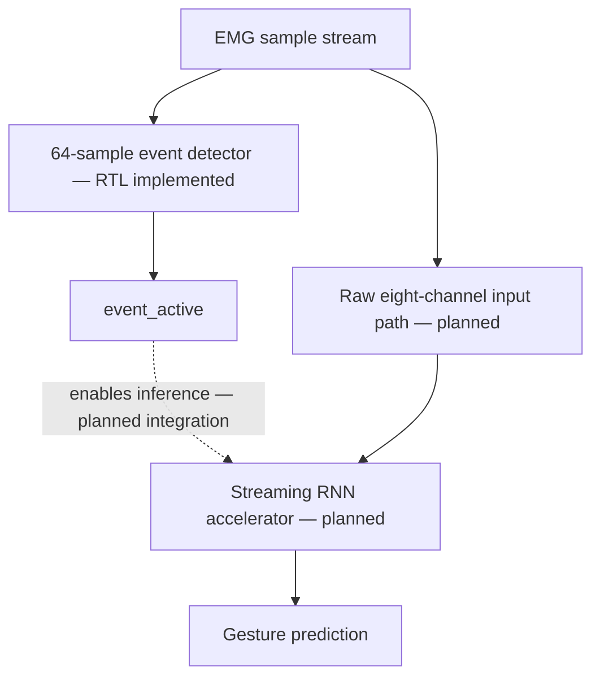

# event-driven-emg-soc

An event-driven SystemVerilog architecture for EMG gesture recognition, combining a lightweight activity detector with a planned quantized neural-network accelerator and eventual RISC-V control.

The system monitors muscle activity continuously and enables neural inference while an event is active. The current accelerator direction is a streaming recurrent neural network (RNN) that processes raw eight-channel EMG samples.

**Current milestone:** the event-detector RTL has passed directed simulation, and FPGA bring-up has been completed on a Tang Primer 25K using a blinking-LED design. The neural-network accelerator and full system integration are still under development.

## Progress at a Glance

| Component | Current status |
| --- | --- |
| Event detector | RTL implemented and checked with directed simulation |
| FPGA bring-up | Gowin synthesis, place and route, programming, and on-board LED demonstration completed |
| Random forest baseline | Approximately 84.5% held-out-subject test accuracy |
| Two-hidden-layer NumPy MLP | Approximately 77.8% validation accuracy and 84.8% test accuracy |
| Streaming RNN | Current model direction; software implementation and evaluation in progress |
| Accelerator | Initial MAC and register components implemented; complete RNN datapath and controller pending |
| INT8 inference | Planned |
| RISC-V SoC integration | Planned |

## System Architecture

The activity detector and gesture classifier have separate responsibilities:

- **Event detector:** determine whether the incoming signal indicates muscle activity.
- **Neural network:** predict the gesture from the incoming EMG sequence.
- **System controller:** coordinate sampling, inference, recurrent state, and output.

The 64-sample sliding window belongs to the event detector. The current RNN direction carries hidden state between successive samples and does not require a fixed 64-sample inference window.

The earlier feature-based MLP experiments still use fixed 64-sample windows. Those experiments remain useful software baselines.

## Event Detector

### Magnitude and Sliding Sum

For each accepted signed sample, the detector computes an unsigned magnitude:

$$
m[n] = |x[n]|
$$

It maintains the sum of magnitudes over a 64-sample detection window:

$$
S[n] = S[n-1] + m[n] - m[n-64]
$$

A circular history buffer supplies the delayed value leaving the window. Each update requires one addition and one subtraction instead of recomputing all 64 terms.

Here, `n` counts accepted samples. Invalid samples must not advance the sample history or update the detector's sample-driven state.

The current detector uses signed 8-bit samples. The most negative input, `-128`, has an unsigned magnitude of `128`. A full window of those samples therefore produces:

$$
64 \times 128 = 8192
$$

This boundary case is included in the directed simulation checks.

### Hysteresis and State Control

The detector uses **Idle**, **Active**, and **Cooldown** states, with separate high and low activity thresholds.

A threshold multiplexer selects the threshold used by the comparator according to the current state. The FSM controls `event_active`, providing hysteresis so signal fluctuations near a threshold do not repeatedly toggle inference.

### Simulation Progress

The event-detector simulation work has covered:

| Check | Behavior exercised |
| --- | --- |
| Reset and startup | Initial state, history handling, and accumulator initialization |
| Sliding accumulation | Addition of the newest magnitude and removal of the delayed magnitude |
| Activation and deactivation | State transitions as signal activity rises and falls |
| Hysteresis | Different activation and release thresholds |
| Pointer wraparound | Circular history addressing across the buffer boundary |
| Invalid samples | Sliding sum and FSM hold when no sample is accepted |
| Maximum magnitude | Signed `-128` handling and a 64-sample sum of `8192` |

These are directed RTL simulation results. Live EMG testing and hardware verification of the complete signal-processing path remain upcoming integration steps.

## FPGA Bring-Up

Initial hardware bring-up has been completed on a **Tang Primer 25K** using **Gowin EDA**.

The completed flow includes:

- FPGA project and target-device setup.
- Synthesis and place and route for the LED bring-up design.
- Pin-constraint troubleshooting.
- Bitstream generation and FPGA programming.
- An observed blinking LED on the board.

The demonstration uses a clock-driven counter to drive an LED. It establishes a working build and programming flow; hardware gesture recognition will require the acquisition path, event detector, and accelerator to be integrated and tested.

## Machine Learning Experiments

### Feature-Based Baselines

The initial software pipeline extracts three time-domain features from each of eight EMG channels over a 64-sample window:

- **Mean Absolute Value (MAV)**
- **Waveform Length (WL)**
- **Zero Crossings (ZC)**

This produces **24 features per window**. Models are evaluated with subject-wise training, validation, and test splits to assess generalization to unseen subjects.

| Model | Architecture or input | Validation accuracy | Test accuracy |
| --- | --- | --- | --- |
| Random forest | 24 extracted features | — | ~84.5% |
| NumPy MLP, one hidden layer | 24 → 32 → 6 | — | — |
| NumPy MLP, two hidden layers | 24 → 32 → 16 → 6 | ~77.8% | ~84.8% |
| Streaming RNN | 8 → recurrent hidden layer (32) → 6 | Pending | Pending |

The MLPs were implemented from scratch using NumPy, including forward propagation, loss calculation, backpropagation, and parameter updates. Experiments explored network depth, hidden-layer widths, learning rates, and training duration.

The reported accuracies are software results from the feature-based experiments. RNN evaluation and quantized-inference results are still pending.

### Current RNN Direction

The current candidate is a compact, streaming, many-to-many RNN:

$$
8 \rightarrow \mathrm{RNN}(32) \rightarrow 6
$$

Each timestep receives one raw sample from each of the eight EMG channels. The network combines those inputs with its previous hidden state and produces six gesture scores.

Its recurrent computation has the form:

$$
h_t = \phi(W_x x_t + W_h h_{t-1} + b_h)
$$

$$
z_t = W_y h_t + b_y
$$

where `x_t` is the eight-channel input, `h_t` is the recurrent state, and `z_t` contains the output scores.

The intended event-driven integration initializes recurrent state at the start of an active event and carries it across successive samples while that event continues. The surrounding controller handles event boundaries; the RNN performs gesture prediction.

Software work currently focuses on the forward pass and backpropagation through time. Model accuracy and implementation cost will determine whether this RNN becomes the final hardware model.

### Experiment Files

The existing feature-based Python experiments are documented in `emg learning/`:

| File | Purpose |
| --- | --- |
| `train_rf.py` | Random forest training and evaluation |
| `fnn.py` | Initial feed-forward neural-network experiments |
| `fnn2.py` | Additional MLP architecture experiments |
| `emg_processing_notes.txt` | EMG processing notes |

## Accelerator Development

Initial reusable accelerator components have been implemented, including a MAC unit, a MAC datapath, and accumulator/register blocks.

The core operation is:

$$
y = \sum_i w_i x_i + b
$$

A complete RNN accelerator also needs:

- Scheduling for the input-to-hidden, hidden-to-hidden, and hidden-to-output computations.
- Hidden-state storage and update control.
- Weight and bias storage.
- Activation-function hardware.
- Fixed-point scaling, rounding, and accumulator-width decisions.
- Sample acceptance and output-valid control.
- Integration with the event detector and the eight-channel input stream.

The initial MAC components are building blocks for this work. The complete recurrent accelerator has not yet been implemented.

## Quantization Plan

**INT8 weights and activations** remain the target for low-precision inference. Accumulation will require wider arithmetic, with the exact formats selected and checked against the chosen model.

The planned flow is:

1. Complete floating-point model training and evaluation.
2. Select the final network and activation function.
3. Evaluate post-training quantization or quantization-aware training.
4. Validate integer inference in software.
5. Export weights, biases, and scaling parameters.
6. Implement the corresponding RTL.
7. Compare RTL results against the integer software reference.
8. Integrate and test inference on the FPGA.

Quantization and hardware/software numerical equivalence are future milestones.

## RTL Components

| File | Role |
| --- | --- |
| `magnitude.sv` | Signed-sample magnitude calculation |
| `fifo.sv` | Circular sample history for delayed-value access |
| `pointer.sv` | Buffer address/pointer control |
| `slider.sv` | Sliding-sum arithmetic |
| `threshold_mux.sv` | State-dependent threshold selection |
| `comparator.sv` | Activity comparison |
| `fsm.sv` | Idle, Active, and Cooldown control |
| `event_detector.sv` | Event-detector integration |
| `mac_unit.sv` | Initial multiply-accumulate component |
| `mac_datapath.sv` | Initial MAC datapath |
| `acc_register.sv` | Accumulation-result storage |
| `register.sv` | Reusable register component |

## Development Checklist

### Event Detector and Verification

- [x] Magnitude calculation
- [x] Circular sample history and pointer logic
- [x] Sliding-window accumulator
- [x] Threshold selection and comparator
- [x] Hysteresis FSM
- [x] Event-detector RTL integration
- [x] Directed event-detector simulation checks
- [ ] Live-input hardware verification

### FPGA Bring-Up

- [x] Gowin project setup
- [x] Synthesis and place and route for the bring-up design
- [x] FPGA programming
- [x] On-board blinking-LED demonstration
- [ ] Integrated EMG system build and timing closure
- [ ] On-board gesture inference

### Machine Learning

- [x] MAV, WL, and ZC feature extraction
- [x] Random forest baseline
- [x] One- and two-hidden-layer NumPy MLP experiments
- [x] Subject-wise model evaluation
- [ ] Complete and evaluate the streaming RNN
- [ ] Finalize the hardware model
- [ ] Validate quantized integer inference
- [ ] Export quantized parameters

### Accelerator and SoC

- [x] Initial MAC unit and MAC datapath
- [x] Accumulator and reusable register blocks
- [ ] Complete accelerator datapath and controller
- [ ] Recurrent hidden-state storage and control
- [ ] Activation-function hardware
- [ ] Weight and bias storage
- [ ] Event-detector/accelerator integration
- [ ] Hardware/software numerical equivalence
- [ ] Multichannel signal-acquisition integration
- [ ] RISC-V control integration
- [ ] Real-time EMG system testing

## Tools

- **SystemVerilog**
- **Icarus Verilog**
- **GTKWave**
- **Python / NumPy**
- **Gowin EDA**
- **Tang Primer 25K FPGA board**

Python supports EMG preprocessing, model training, evaluation, quantization, and parameter export. SystemVerilog is used for the custom signal-processing and inference hardware.

## Long-Term Goal

The intended SoC combines EMG acquisition, continuous event detection, a quantized streaming classifier, and a RISC-V processor for system-level control and application output.

The project explores event-driven inference, FPGA signal processing, neural-network acceleration, and hardware/software integration. Reducing unnecessary inference during inactive periods is a design objective; power and end-to-end performance measurements will follow system integration.

